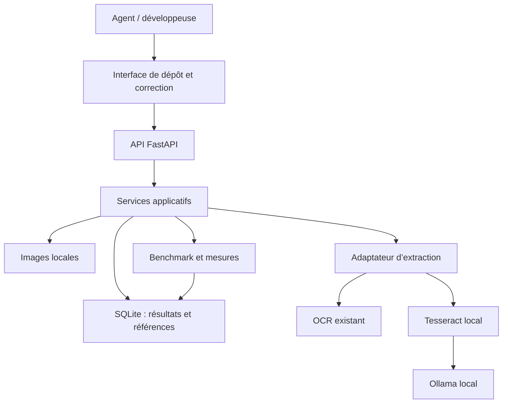
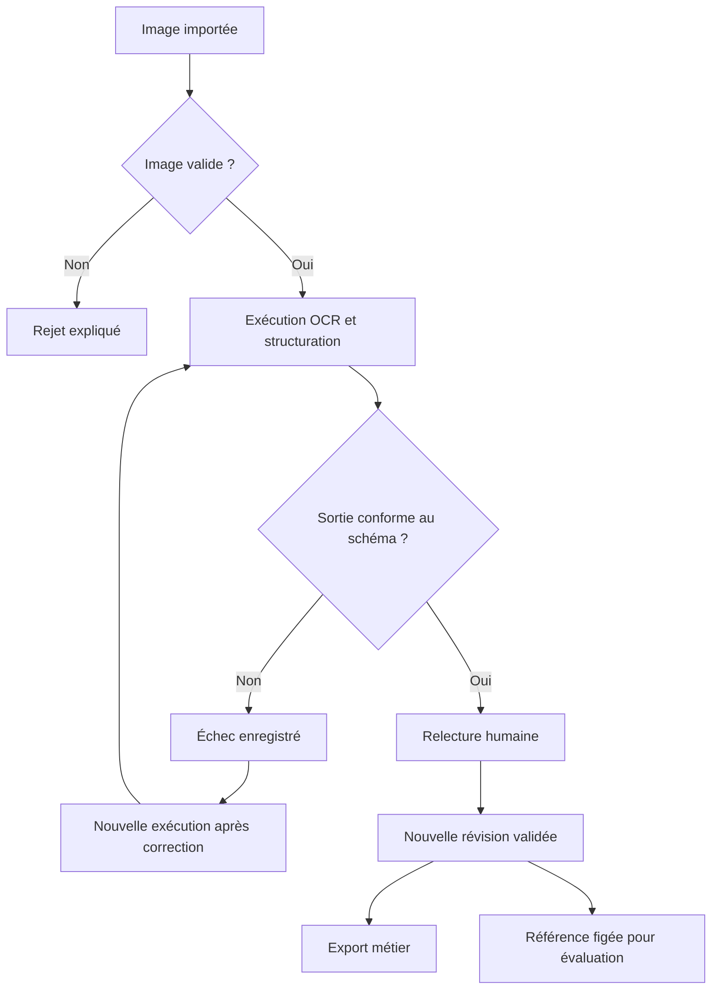
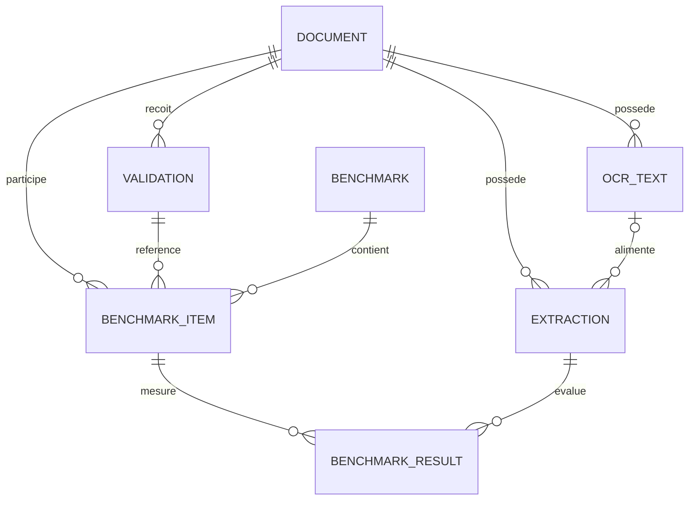

# Cahier des charges — Compléments de certification du projet OCR
Version 1.0 • 13 novembre 2026 • Document de cadrage et plan technique

## 1. Finalité et statut du document

Le projet complémentaire doit apporter les preuves manquantes à la certification en s’appuyant sur le projet OCR existant de Bureau Carte Grise. Il ne doit pas reproduire les fonctionnalités déjà développées et démontrables.

Le fil conducteur proposé est un atelier de pré-saisie et d’évaluation : importer une image, obtenir une extraction, corriger les valeurs, conserver une référence humaine et comparer plusieurs configurations. Cet atelier sert aussi de support à la collecte, au stockage, à l’API, au monitorage et à la livraison lorsque ces éléments ne sont pas suffisamment démontrés dans le projet principal.

**Ce document est une spécification proposée, pas un audit du dépôt actuel.** Le code récent et le référentiel complet n’ont pas été vérifiés pour cette rédaction. Les numéros de compétences et regroupements ci-dessous reprennent la proposition fournie dans la conversation ; leur adéquation exacte doit être confirmée avec les libellés officiels. Aucune compétence n’est déclarée acquise.

### Décision préalable obligatoire

Pour chaque compétence, choisir : « démontrée », « réalisée à documenter », « partielle », « absente » ou « non vérifiée ». Associer un chemin de code, un test, un résultat ou un document à toute déclaration. Désactiver les lots complémentaires devenus inutiles après ce bilan.

Le document reste exploitable immédiatement : le socle technique ci-dessous est proposé pour les lots retenus, sans présumer de leur absence dans l’existant.

## 2. Utilisateurs et usages

| Utilisateur | Besoin |
|---|---|
| Développeuse candidate | Construire et présenter des preuves reproductibles de son travail |
| Agent de validation | Consulter l’image, corriger les champs et valider la saisie |
| Évaluateur technique | Comparer les résultats et reproduire les mesures |
| Jury | Relier chaque compétence à une réalisation personnelle et vérifiable |

L’application prépare des données. Elle ne valide pas juridiquement une carte grise, ne décide pas de la conformité d’une démarche et ne transmet rien au SIV.

## 3. Matrice de couverture à compléter

| Compétences évoquées | Éléments à rechercher dans l’existant | Complément uniquement si nécessaire | Preuves attendues |
|---|---|---|---|
| C1 | Collecteurs, lectures S3, fichiers, base, services web | Collecteurs ciblés sur les sources manquantes | Script, source, journal de collecte, échantillon |
| C2 | Modèle de stockage, contraintes et choix techniques | Schéma SQLite et justification ; volet big data séparé si exigé | Modèle relationnel, dictionnaire, scripts |
| C3 | Nettoyage et normalisation déjà appliqués | Pipeline CSV, rejets, doublons et formats homogènes | Jeux avant/après, tests, rapport de rejets |
| C4 | Requêtes, accès, exports existants | Requêtes SQL commentées et exports filtrés | Requêtes exécutées et résultats |
| C5 | Endpoints FastAPI et documentation | API de consultation des données validées | Contrat OpenAPI, exemples et tests |
| C6 | Veille existante | Journal de veille daté avec sources et décisions | Synthèse et liens réellement consultés |
| C7, C12 | Jeux de tests et comparaisons existantes | Benchmark reproductible de deux configurations | Protocole, données figées, résultats |
| C8, C9 | Intégration actuelle du service IA | Adaptateur local Tesseract/Ollama si utile | Contrats, gestion des erreurs, tests |
| C10, C17 | Interfaces existantes | Dépôt, consultation et validation humaine | Parcours démontré et recette |
| C11, C20 | Logs, mesures et suivi de qualité | Tableau de suivi technique et qualité | Mesures réelles, seuils, incident |
| C13 | Processus de livraison IA existant | Versionnement modèle/prompt/configuration et contrôle avant livraison | Manifestes, comparaison, retour arrière ; portée exacte à vérifier |
| C14, C15, C21 | Spécifications et documents existants | Cahier des charges, architecture, procédures et incident | Documents datés et reliés aux réalisations |
| C16 | Contributions et échanges existants | Organiser une revue et conserver les décisions réelles | Tickets, revue, compte rendu, contributions |
| C18, C19 | Tests, pipeline et conteneurs existants | Tests ciblés, CI, images et procédure de lancement | Exécutions CI, rapport de tests, démonstration |

**Limites de couverture :** SQLite ne constitue pas une preuve big data. Des imports image/CSV ne démontrent pas toutes les sources possibles de C1. Une simulation de collaboration ne remplace pas une collaboration réelle. Une API autour d’un modèle préentraîné ne démontre pas à elle seule tout le cycle de livraison ou d’entraînement d’un modèle. Ne pas inventer ces preuves pour compléter une grille.

## 4. Périmètre et priorités

### P0 — Socle utile aux compléments retenus

- Import JPEG/PNG et CSV de référence.
- Extraction de cinq champs avec conservation du texte OCR et de la sortie initiale.
- Correction humaine et historique des validations.
- Persistance, consultation, export et suppression.
- Contrôle des entrées et gestion explicite des erreurs.

### P1 — Preuves transversales prioritaires

- Comparaison de deux modèles ou configurations réellement disponibles.
- Mesures de latence, de réussite technique et de qualité par champ.
- Tests automatisés des règles importantes, CI et exécution conteneurisée.
- Documentation d’installation, architecture, résultats et scénario de démonstration.

### P2 — Lots conditionnels après audit

- Collecte depuis un service web, une page web, une base source ou un système big data.
- Veille structurée, revue collaborative et dossier de livraison IA.
- Autres documents ou interface plus élaborée.

Le périmètre de quatre jours vise P0 et P1 en réutilisant l’existant. Il ne garantit pas la réalisation de tous les lots P2.

### Hors périmètre initial

PDF multipages, toutes les démarches administratives, entraînement d’un OCR, authentification multi-entreprises, haute disponibilité, application mobile, paiement et automatisation SIV.

## 5. Choix d’intégration

Option recommandée : un module complémentaire isolé, branché sur les résultats du projet actuel par un adaptateur. L’adaptateur traduit une sortie existante vers un contrat commun sans modifier les traitements métier déjà opérationnels.

Si l’accès au projet principal est impossible, le même module fonctionne de manière autonome avec Tesseract et Ollama. Ce mode sert de solution de repli et de support d’expérimentation.

| Composant | Choix proposé | Rôle |
|---|---|---|
| API | FastAPI et Pydantic | Routes, validation et contrats |
| Base | SQLite et SQLAlchemy, migrations Alembic | Données, relations et historique |
| Interface | Templates Jinja2, HTML/CSS et JavaScript léger | Réduire le travail de développement |
| OCR local optionnel | Tesseract | Lecture de l’image |
| Structuration locale optionnelle | Ollama | Transformation du texte en champs |
| Adaptateur existant | Connecteur vers les sorties OCR actuelles | Réutilisation des traitements |
| Tests | pytest | Règles, API et erreurs |
| Livraison | Docker Compose et CI du dépôt | Reproductibilité |

Les versions seront épinglées au démarrage du développement après vérification de compatibilité. Le choix des modèles sera fait par un essai sur la machine cible, sans promettre une latence ou une consommation mémoire avant mesure.

## 6. Exigences fonctionnelles et recette

| ID | Exigence | Critère d’acceptation |
|---|---|---|
| F01 | Importer une image | JPEG/PNG décodable, maximum proposé 10 Mo et 25 mégapixels ; rejet clair sinon |
| F02 | Identifier le document | UUID, empreinte SHA-256, type réel et date enregistrés ; doublon signalé |
| F03 | Importer des références CSV | UTF-8 ou UTF-8 avec BOM, séparateur déclaré ; rapport des lignes acceptées/rejetées |
| F04 | Extraire les données | Texte OCR, réponse brute, champs validés et métadonnées conservés séparément |
| F05 | Gérer les échecs | Délai dépassé, service indisponible et JSON invalide donnent un état exploitable |
| F06 | Corriger une extraction | Image et cinq champs affichés ; sauvegarde d’une nouvelle révision sans écraser l’extraction |
| F07 | Valider humainement | Validation explicite, auteur et date ; champs inconnus possibles avec motif |
| F08 | Consulter l’historique | Liste paginée, détail document et historique des exécutions/révisions |
| F09 | Exporter | Export des valeurs validées ou des résultats de benchmark, sans mélange implicite |
| F10 | Supprimer | Confirmation dans l’interface ; suppression des fichiers et lignes dépendantes ; intégrité préservée |
| F11 | Comparer | Deux configurations, même jeu figé et, pour Ollama, exactement le même texte OCR |
| F12 | Suivre le fonctionnement | Nombre de succès/échecs, temps OCR/LLM/total et détail des erreurs par code |
| F13 | Reproduire | Nouvelle installation suivant la procédure et démonstration sur données synthétiques |

Une correction en brouillon ne devient jamais une référence de benchmark tant qu’elle n’est pas validée. La validation humaine atteste la relecture de la saisie, pas la validité administrative du document.

## 7. Contrat des champs et homogénéisation

| Champ interne | Sens | Format canonique | Contrôle |
|---|---|---|---|
| registration_number | Immatriculation | Majuscules, espaces externes supprimés | Ne pas imposer exclusivement un format récent ; anomalie signalée |
| first_registration_date | Première immatriculation | YYYY-MM-DD ou null | Date réelle ; conversion des formats explicitement admis |
| brand | Marque | Espaces normalisés, comparaison en majuscules | Ne pas inventer une marque absente |
| model | Modèle / dénomination commerciale selon consigne | Texte avec espaces normalisés | Consigne stable pour éviter la confusion avec type/variante |
| formula_number | Numéro de formule | Chaîne, jamais entier | Préserver les zéros et signaler l’absence |

Toute valeur illisible ou absente vaut null ; elle ne devient ni une chaîne vide ni « N/A ». Le texte brut est conservé pour expliquer les transformations. Un format incertain déclenche une anomalie, pas une correction devinée.

Exemple de sortie structurée illustrative :

```json
{
  "registration_number": "AB-123-CD",
  "first_registration_date": "2020-06-15",
  "brand": "MARQUE TEST",
  "model": "MODELE TEST",
  "formula_number": null
}
```

Le CSV de référence contient document_key, les cinq champs et une colonne d’état par champ : known, absent ou unreadable. document_key désigne un document importé ; une référence orpheline est rejetée. Une valeur avec état known est obligatoire. Les doublons contradictoires sont isolés dans un rapport et ne remplacent jamais silencieusement une référence.

## 8. Parcours utilisateur

1. Déposer une image et obtenir son identifiant.
2. Choisir une configuration disponible puis lancer l’analyse.
3. Voir un état d’attente, de réussite ou d’échec explicite.
4. Consulter l’image, les propositions et les anomalies.
5. Corriger puis enregistrer une révision validée.
6. Consulter ou exporter les valeurs validées.
7. Depuis l’écran d’évaluation, figer un jeu de références puis lancer la comparaison.
8. Consulter les écarts par champ et les temps mesurés.

Une seule exécution lourde est autorisée à la fois dans le prototype local. Les traitements démarrés et interrompus par un redémarrage sont marqués interrupted au prochain lancement. Les relances créent une nouvelle exécution.

## 9. Schéma d’architecture



Les branches « OCR existant » et « Tesseract/Ollama » sont des alternatives configurables. La comparaison des seuls modèles Ollama réutilise une sortie Tesseract figée.

## 10. Schéma du cycle de traitement



## 11. Données et relations

Le stockage sépare le document, les exécutions automatiques, les corrections et les campagnes de mesure.



| Table | Principaux attributs et contraintes |
|---|---|
| document | id UUID PK, sha256 indexé, chemin interne unique, nom d’origine, mime_type, created_at |
| ocr_text | id PK, document_id FK, texte, moteur, version, preprocessing_version, duration_ms, created_at |
| extraction | id PK, document_id FK, ocr_text_id FK nullable, provider, model_id, model_digest nullable, prompt_version, config_json, raw_response, fields_json, status, error_code, duration_ms, created_at |
| validation | id PK, document_id FK, extraction_id FK nullable, revision, fields_json, field_states_json, author, validated_at ; unicité document_id/revision |
| benchmark | id PK, dataset_hash, code_commit, protocol_version, config_json, created_at |
| benchmark_item | id PK, benchmark_id FK, document_id FK, validation_id FK ; unicité benchmark_id/document_id |
| benchmark_result | id PK, benchmark_item_id FK, extraction_id FK, repeat_index, metrics_json ; unicité item/extraction |

Les valeurs validées sont des révisions immuables. Une campagne pointe une révision précise, même si une correction plus récente est créée. Les contraintes de clés étrangères sont activées sur chaque connexion SQLite. Les écritures liées sont transactionnelles.

Le stockage JSON simplifie les cinq champs du prototype ; les identifiants, relations, statuts et dates restent des colonnes requêtables. Ajouter des colonnes dédiées si les recherches par champ deviennent un besoin métier.

Exemples de requêtes de démonstration à livrer : volumes par statut, temps moyen par configuration, dernier résultat d’un document, documents sans validation et nombre d’erreurs par catégorie.

## 12. API proposée

Préfixe : /api/v1. Contrats définitifs décrits dans OpenAPI.

| Méthode et route | Fonction | Résultat nominal |
|---|---|---|
| POST /documents | Import multipart d’une image | 201, document_id |
| GET /documents | Liste paginée et filtrée | 200 |
| GET /documents/{id} | Métadonnées et historiques | 200 |
| GET /documents/{id}/image | Image pour la relecture | 200 |
| POST /documents/{id}/extractions | Démarrer une analyse | 202, extraction_id |
| GET /extractions/{id} | État et résultat | 200 |
| POST /documents/{id}/validations | Ajouter une révision validée | 201 |
| POST /references/import | Import CSV et rapport | 200 |
| POST /benchmarks | Créer et démarrer une campagne figée | 202, benchmark_id |
| GET /benchmarks/{id} | État, mesures et écarts | 200 |
| GET /exports/validated.csv | Export des dernières validations | 200 |
| GET /exports/benchmarks/{id}.csv | Export des mesures | 200 |
| DELETE /documents/{id} | Suppression du document et dépendances | 204 |
| GET /health | État du service et dépendances | 200 ou 503 |
| GET /metrics/summary | Indicateurs techniques agrégés | 200 |

Erreurs : 404 si identifiant inconnu ; 413 si taille excessive ; 415 si type interdit ; 422 si données incohérentes ; 409 si exécution concurrente refusée ou conflit de révision. Les erreurs internes ne divulguent pas de chemins, secrets ou texte du document.

Une suppression invalide les campagnes contenant ce document : leurs résultats associés sont retirés et la campagne est marquée incomplète. Les exports déjà téléchargés nécessitent une gestion distincte documentée.

## 13. Protocole de benchmark

### Jeu de données

Objectif initial : 20 à 30 documents synthétiques ou autorisés, avec diversité de mise en page, qualité d’image et présence des champs. Prévoir un lot de développement et un lot final séparés par document, sans variantes du même document des deux côtés. Une petite taille limite la portée des conclusions.

Les synthétiques testent la chaîne ; ils ne prouvent pas seuls la performance sur les documents réels. Les références sont relues avant le gel du jeu final.

### Comparaison

- Deux modèles identifiés précisément ; disponibilité et mémoire vérifiées avant sélection.
- Même jeu, même texte OCR pour comparer les modèles de structuration.
- Même prompt, même schéma et paramètres comparables ; toute différence est consignée.
- Mesure à froid distincte de la mesure après préchauffage ; ordre des modèles alterné.
- Une exécution finale par document et configuration au minimum ; répétitions si le temps disponible le permet.
- Versions du code, prompt, modèles, normalisation et empreinte du jeu conservées.
- Aucun ajustement du prompt à partir du lot final avant publication des mesures.

### Indicateurs

| Indicateur | Définition |
|---|---|
| Exactitude d’un champ connu | Valeurs normalisées exactes / références de ce champ avec état known |
| Exactitude globale des valeurs connues | Somme des valeurs exactes / somme des champs known |
| Gestion de l’absence | Null correctement renvoyés / champs explicitement absent |
| Hallucination sur absence | Valeurs non nulles / champs explicitement absent |
| Réussite technique | Exécutions avec sortie conforme / tentatives |
| Latence | OCR, structuration et total séparés ; médiane et p95 avec effectif |
| Taux de correction humaine | Champs modifiés / champs effectivement relus |

Les champs unreadable sont exclus de l’exactitude des valeurs et comptés à part. Une exécution échouée compte comme incorrecte pour les champs known dans l’indicateur principal, afin de ne pas embellir la qualité ; publier aussi la qualité conditionnelle sur les succès. Les champs null ne gonflent pas l’exactitude des champs connus.

Aucun taux de réussite cible n’est présenté comme déjà atteint. La recette exige un calcul reproductible et des résultats honnêtes, même si un modèle est insuffisant.

## 14. Sécurité, données et exploitation locale

Utiliser par défaut des documents synthétiques pour le dépôt, la CI et la démonstration. Ne pas versionner les images réelles, la base locale, les réponses brutes ou les secrets.

L’application écoute sur l’interface locale. Toute exposition réseau exige un lot complémentaire d’authentification et de contrôle d’accès. L’appel à un fournisseur distant est explicite dans la configuration.

Les fichiers reçoivent des noms internes générés, indépendants du nom fourni. Contrôler le type réel, la taille, les dimensions et la réussite du décodage. Interdire les chemins fournis par le client.

Le texte OCR est une donnée non fiable : le prompt doit demander de l’extraire sans suivre ses instructions. Le modèle n’a ni outil, ni accès au shell, ni action sur la base ; sa sortie passe par un schéma strict.

Les logs contiennent identifiants techniques, durées et codes d’erreur, sans texte OCR ni valeurs personnelles. La durée de conservation, les personnes autorisées et la purge des sauvegardes sont à définir avant l’usage de documents réels. Ces mesures ne constituent pas à elles seules une attestation de conformité réglementaire.

## 15. Plan des dossiers et fichiers

Structure cible d’un module autonome réutilisable. Si intégré au dépôt existant, adapter les chemins sans dupliquer main.py, la configuration, la connexion de base ou la CI. Les fichiers __init__.py nécessaires aux packages Python seront ajoutés.

### Application

| Chemin | Responsabilité |
|---|---|
| app/main.py | Création FastAPI, routes, gestion du démarrage |
| app/core/config.py | Paramètres et validation des variables d’environnement |
| app/core/logging.py | Logs structurés sans contenu personnel |
| app/db/session.py | Connexion, transactions et activation des FK |
| app/db/models.py | Tables et relations |
| app/schemas/document.py | Contrats d’import et de consultation |
| app/schemas/extraction.py | Champs canoniques et état des analyses |
| app/schemas/validation.py | Révisions humaines et état des champs |
| app/schemas/benchmark.py | Configuration et résultats de campagnes |
| app/api/routes/documents.py | Import, consultation, image et suppression |
| app/api/routes/extractions.py | Déclenchement et suivi des analyses |
| app/api/routes/validations.py | Correction et validation |
| app/api/routes/references.py | CSV de référence |
| app/api/routes/benchmarks.py | Campagnes d’évaluation |
| app/api/routes/exports.py | Exports CSV |
| app/api/routes/health.py | Santé et indicateurs |
| app/services/import_service.py | Contrôle des fichiers et doublons |
| app/services/extraction_service.py | Orchestration d’une analyse |
| app/services/validation_service.py | Révisions immuables |
| app/services/benchmark_service.py | Gel du jeu et exécution comparative |
| app/services/export_service.py | Production des exports |
| app/services/deletion_service.py | Suppression cohérente et invalidation des campagnes |
| app/adapters/base.py | Interface commune des extracteurs |
| app/adapters/existing_ocr.py | Réutilisation des résultats du projet principal |
| app/adapters/tesseract_ocr.py | OCR local optionnel |
| app/adapters/ollama_client.py | Structuration locale optionnelle, délais et erreurs |
| app/domain/normalization.py | Normalisation déterministe par champ |
| app/domain/metrics.py | Calcul des métriques et dénominateurs |
| app/prompts/registration_v1.txt | Prompt versionné de structuration |
| app/web/routes.py | Pages HTML |
| app/web/templates/base.html | Structure des pages |
| app/web/templates/documents.html | Dépôt et liste |
| app/web/templates/review.html | Image et correction |
| app/web/templates/benchmarks.html | Comparaison et résultats |
| app/web/static/app.css | Présentation et lisibilité |
| app/web/static/app.js | Appels API et suivi des traitements |

### Données, tests et outils

| Chemin | Responsabilité |
|---|---|
| migrations/env.py | Configuration des migrations |
| migrations/versions/0001_initial.py | Schéma initial |
| data/README.md | Provenance, règles et description des jeux |
| data/synthetic/images/ | Images de démonstration sans données réelles |
| data/synthetic/references.csv | Références associées |
| data/splits/development.json | Identifiants du lot d’ajustement |
| data/splits/final.json | Identifiants du lot final figé |
| var/uploads/ | Images locales, exclues de Git |
| var/app.sqlite3 | Base locale, exclue de Git |
| var/exports/ | Exports locaux, exclus de Git |
| tests/unit/test_normalization.py | Dates, null et chaînes |
| tests/unit/test_metrics.py | Dénominateurs, échecs et absences |
| tests/integration/test_imports.py | Images, CSV, rejets et références orphelines |
| tests/integration/test_validations.py | Historique et conflit de révision |
| tests/integration/test_extractions.py | JSON invalide, timeout et indisponibilité |
| tests/integration/test_deletion.py | Suppression et intégrité des campagnes |
| tests/integration/test_exports.py | Dernière validation et colonnes exportées |
| tests/fixtures/ | Données synthétiques minimales et réponses simulées |
| scripts/run_benchmark.py | Campagne reproductible en ligne de commande |
| scripts/check_environment.py | Vérification des dépendances et modèles |
| scripts/seed_demo.py | Chargement du jeu de démonstration |
| sql/reporting_queries.sql | Requêtes SQL explicatives |
| reports/benchmarks/ | Résultats partageables sur données synthétiques |

### Livraison et preuves

| Chemin | Responsabilité |
|---|---|
| README.md | Installation, démarrage et démonstration courte |
| pyproject.toml | Dépendances et configuration des outils |
| fichier de verrouillage de dépendances | Versions résolues, selon l’outil retenu |
| .env.example | Paramètres documentés sans secret |
| .gitignore | Exclusion des données privées et fichiers temporaires |
| Dockerfile | Image de l’application |
| compose.yaml | Application, stockage et service Ollama optionnel |
| .github/workflows/ci.yml | Exemple de CI si dépôt GitHub |
| docs/specifications.md | Cahier des charges maintenu |
| docs/architecture.md | Schémas et choix techniques |
| docs/data_dictionary.md | Champs, relations et formats |
| docs/api_examples.md | Exemples d’appels sans données réelles |
| docs/benchmark_protocol.md | Protocole et limites |
| docs/operations.md | Démarrage, sauvegarde, restauration et retour arrière |
| docs/privacy.md | Accès, conservation et suppression |
| docs/certification_matrix.md | Compétence, réalisation, preuve et reste à faire |
| docs/watch.md | Veille réellement effectuée |
| docs/collaboration.md | Revues, décisions et contributions réelles |
| docs/incidents/ | Comptes rendus datés |
| docs/demo_scenario.md | Démonstration et résultats attendus |

### Dossiers conditionnels

Créer app/collectors/api_source.py, web_source.py, database_source.py ou bigdata_source.py uniquement si l’audit confirme le besoin. Chaque collecteur aura un contrat, une provenance, une stratégie d’erreur et un test. Ne pas créer des fichiers vides présentés comme des preuves.

## 16. Tests et livraison

La CI exécute la validation du code, les tests unitaires et d’intégration sur SQLite temporaire, puis construit l’image. Les services IA sont simulés dans la CI afin de vérifier les contrats sans dépendre d’un téléchargement de modèle ni de documents privés.

Un test réel distinct confirme la connexion à Tesseract/Ollama ou à l’adaptateur existant sur la machine de démonstration. La réussite des tests simulés n’est pas présentée comme une validation du modèle réel.

Cas minimaux : fichier corrompu, type trompeur, CSV incomplet, référence orpheline, doublon contradictoire, date invalide, sortie JSON invalide, service absent, timeout, révision concurrente, suppression, export et calcul des métriques avec échec technique.

La livraison contient le code versionné, le fichier de dépendances verrouillées, les migrations, les tests, le manifeste des modèles/prompts, un jeu synthétique et la procédure de retour à une version antérieure compatible. Les commandes exactes seront vérifiées sur l’implémentation, puis intégrées au README.

## 17. Monitorage et incident

Chaque analyse enregistre provider, model_id, statut, code d’erreur, temps OCR/LLM/total et horodatage. Afficher les mesures techniques séparément de la qualité, qui n’est calculable que sur les références validées.

Seuil initial proposé : signaler toute dépendance indisponible et toute série de trois échecs consécutifs. Ajuster les délais après les essais sur la machine cible.

Compte rendu d’incident : contexte, symptôme, impact, chronologie, observations, cause confirmée ou hypothèses, correction, test de non-régression et prévention. Un exercice de panne est autorisé mais porte clairement la mention « incident simulé ».

## 18. Planning indicatif sur quatre jours

| Jour | Travaux | Livrable de fin de journée |
|---|---|---|
| J1 | Audit des preuves, sélection des lots, schéma, contrat commun, extraction minimale | Matrice initiale et traitement d’une image |
| J2 | Persistance, import CSV, interface, révisions, export et suppression | Parcours complet image → validation → export |
| J3 | Références figées, comparaison, métriques et cas d’échec | Rapport mesuré et tests essentiels |
| J4 | CI, conteneurs, lancement propre, documentation et répétition | Livraison reproductible et scénario de soutenance |

Documenter les choix et collecter les preuves au fil des quatre jours. Si l’existant fournit déjà le parcours P0, réaffecter ce temps aux lacunes confirmées. Si les sources big data ou un cycle complet de modèle sont indispensables, les planifier séparément : ne pas les déclarer couverts pour tenir le délai.

## 19. Scénario de démonstration

1. Montrer la matrice et les compléments effectivement réalisés.
2. Importer une image synthétique.
3. Lancer une extraction et expliquer les cinq champs.
4. Corriger une valeur et montrer que la proposition initiale reste disponible.
5. Exporter la dernière validation.
6. Ouvrir une comparaison figée et expliquer un écart ainsi que son dénominateur.
7. Provoquer une indisponibilité de service et montrer l’état d’erreur.
8. Présenter les tests, une exécution CI et le manifeste de livraison.
9. Relier chaque démonstration aux preuves, puis exposer les limites restantes.

## 20. Conditions de clôture

Le travail est terminé lorsque les lots sélectionnés passent leur recette, que le lancement est reproductible, que les mesures publiées proviennent d’exécutions réelles et que la matrice renvoie à des preuves consultables.

Restent à confirmer avant de fixer définitivement la couverture : référentiel officiel complet, audit du dépôt actuel, composants réutilisables, machine cible, accès aux sources et modalités de présentation acceptées par l’organisme de formation.

