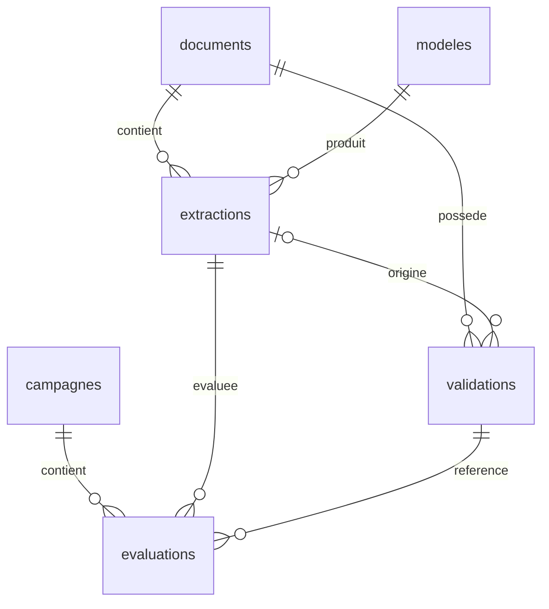

# Persistance SQLite locale

Ce module est indépendant de l’API et des connecteurs OCR/IA. Il utilise `sqlite3` et ne crée aucune table de comptes. Les fichiers image restent sur disque, sans BLOB. Les images, chemins, textes et identifiants de véhicule peuvent contenir des données personnelles ; le module ne les journalise pas. Protéger l’accès au fichier SQLite et aux exports : aucune gestion des comptes, du chiffrement ou des droits d’accès n’est fournie.



`documents` déduplique l'empreinte SHA-256 ; le nom interne est un identifiant aléatoire. `modeles` identifie fournisseur, nom et version ; une chaîne vide signifie une version inconnue, et n'est pas une version inventée. `extractions` conserve chaque exécution, ses paramètres JSON, ses durées et son état. `validations` conserve les corrections confirmées, avec états `known`, `absent` ou `unreadable` et révisions immuables. Les références CSV peuvent être enregistrées sans extraction. `campagnes` décrit le protocole et le jeu de référence ; chaque ligne d'`evaluations` compare un champ à une révision précise. Une campagne utilise la même révision pour un document donné. Les contraintes de clés étrangères, d'unicité, de cohérence et les triggers sont dans [schema.sql](schema.sql). L'attribution de révision utilise une transaction `BEGIN IMMEDIATE`.

Depuis `app/`, initialiser et tester :

```bash
python3 -m persistence.database
python3 -m unittest discover -s tests -v
```

La base est par défaut `app/var/ocr_evaluation.sqlite3`. Pour choisir un autre emplacement avant l'initialisation :

```bash
export OCR_DB_PATH=/chemin/local/ocr_evaluation.sqlite3
python3 -m persistence.database
```

On peut aussi passer le chemin à `Database(path)`. L'initialisation est répétable et ne supprime pas les données ; elle crée les objets manquants, mais ne constitue pas une migration d'un schéma préexistant incompatible. Ne pas pointer vers une base d'une autre application. SQLite doit fournir l'extension JSON intégrée.

Exemple intégralement fictif, depuis `app/` :

```python
from persistence.database import Database, FIELDS

db = Database()
db.initialize()
doc = db.document('a' * 64, '/fictif/image.png')  # empreinte fictive ; calculer SHA-256 du fichier réel à l'import
model = db.modele('fournisseur fictif', 'modèle fictif', None)
x = db.creer_extraction(doc['id'], model['id'], 'prompt-1', {'temperature': 0})
db.etat_extraction(x, 'running')
db.etat_extraction(x, 'succeeded', marque='Exemple', duree_modele_ms=25)
values = dict.fromkeys(FIELDS)
values['marque'] = 'Exemple'
states = {f: ('known' if f == 'marque' else 'absent') for f in FIELDS}
v = db.valider(doc['id'], values, states, extraction_id=x)
latest = db.derniere_validation(doc['id'])
page = db.documents(limit=20, offset=0)
history = db.historique(doc['id'])
campaign = db.campagne('Essai fictif', '1', 'empreinte fictive', 'revision fictive')
db.evaluer(campaign, x, v, 'marque', 1)
db.evaluer(campaign, x, v, 'numero_formule', None, 'référence absente')
db.exporter_csv('exports/resultat.csv')  # créer le dossier exports au préalable
db.supprimer_document(doc['id'])
```

Un échec ou une interruption se signale par `etat_extraction(x, 'failed', code_erreur='OCR_ERREUR')` ou `interrupted` ; les codes sont symboliques et ne doivent pas contenir de données personnelles. Les transitions possibles sont `pending` vers `running`, `failed` ou `interrupted`, puis `running` vers `succeeded`, `failed` ou `interrupted`. Les états terminaux ne sont pas réutilisés : une relance crée une extraction. Les valeurs `known` doivent être des chaînes non vides ; les autres valent `None`. Les dates métier utilisent `YYYY-MM-DD`, les dates générées sont en UTC ISO 8601.

La suppression est transactionnelle : toutes les campagnes contenant une évaluation du document sont supprimées avec toutes leurs évaluations, puis le document et ses extractions et validations sont supprimés. Cela évite de présenter un benchmark partiel comme complet. Le fichier image lui-même n'est jamais supprimé par cette couche.

[requetes.sql](requetes.sql) fournit les listes, les dernières références, les comptes, les durées moyennes et les erreurs d'une campagne. Le taux utilise `AVG(est_correct)` et `COUNT(est_correct)` : les valeurs NULL sont exclues du numérateur et du dénominateur ; un groupe sans valeur évaluée a un taux NULL et un effectif nul. Remplacer l'identifiant de campagne `1` pour choisir une campagne. Le plan `EXPLAIN QUERY PLAN` permet d'inspecter le choix des index sans conclure à un gain non mesuré. Ces requêtes montrent des opérations SQL classiques sur une base locale ; aucune partie big data ou Spark n'est réalisée.

Les bases, répertoires d'images et CSV sont exclus par `.gitignore`. Éviter aussi de placer des données réelles dans d'autres chemins versionnés ; les règles Git ne protègent pas les fichiers déjà suivis.
